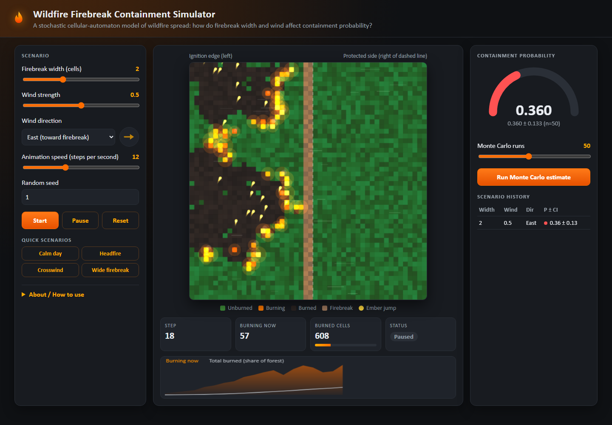
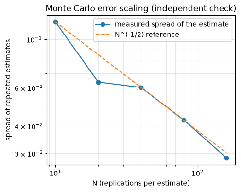
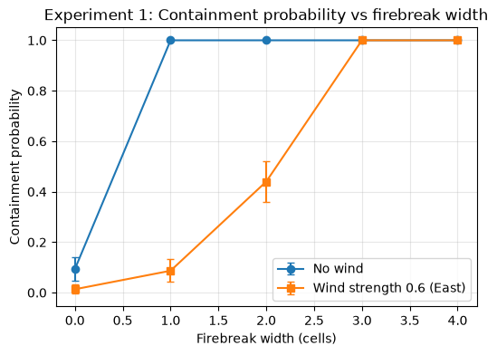
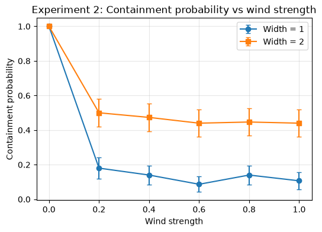
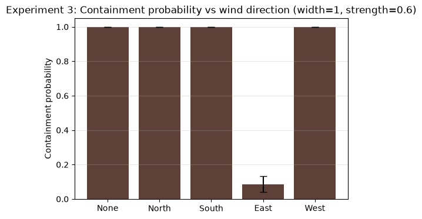
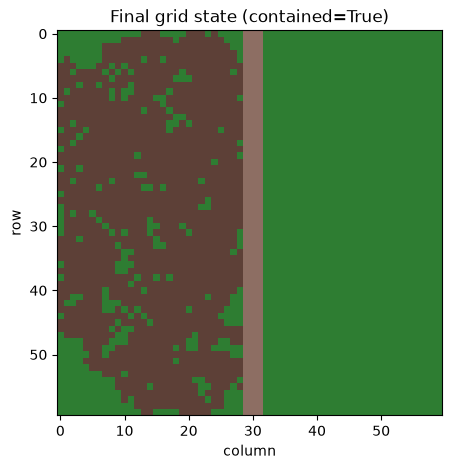
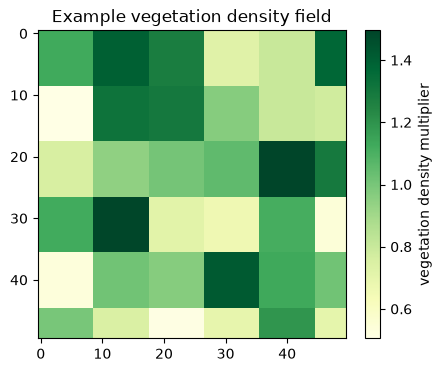
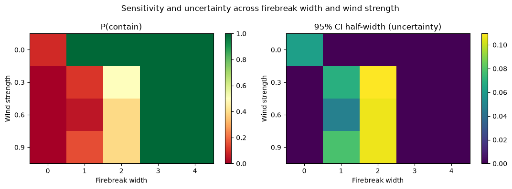

# Wildfire Firebreak Containment Simulator

A stochastic grid simulation of wildfire spread that estimates how likely a firebreak is to stop a fire, for different firebreak widths and wind conditions.

**[Live demo](https://ManithMss.github.io/wildfire-firebreak-simulator/)** · [](https://colab.research.google.com/github/ManithMss/wildfire-firebreak-simulator/blob/main/notebook/wildfire-firebreak-simulator.ipynb)



## The problem

A firebreak is a strip of land cleared of vegetation so that a wildfire has nothing to burn when it reaches it. How wide it needs to be depends a lot on the wind: wind pushes the fire forward and can carry burning embers over a strip that would otherwise stop it. This project simulates a fire spreading across a grid with a firebreak of adjustable width and asks: how does firebreak width affect the probability of containing the fire under different wind strengths and directions, when embers can jump the firebreak?

This is useful for anyone planning fire protection strips. A firebreak that works on a calm day can fail when the wind blows straight at it, and the simulation shows how much wider it needs to be as conditions get worse.

## Quick start

**Notebook:** click the *Open in Colab* badge above, then *Runtime -> Run all*. It needs no extra installs and took about 3 minutes to run end to end on a laptop CPU (a free Colab runtime may take a few minutes longer).

**Web demo:** open the [live demo](https://ManithMss.github.io/wildfire-firebreak-simulator/), or download this repository and double-click `docs/index.html`.

**Run locally (optional):**

```bash
pip install -r requirements.txt
jupyter notebook notebook/wildfire-firebreak-simulator.ipynb
```

## Using the demo

Set the firebreak width, wind strength and wind direction, then press Start to watch one fire spread on the grid. The quick scenario buttons (Calm day, Headfire, Crosswind, Wide firebreak) load a setting and start it. Press "Run Monte Carlo estimate" to run many fast simulations and get the probability that the fire is contained, with a 95% confidence interval; each result is added to a history table so settings can be compared. Full guide: [USER_GUIDE.md](USER_GUIDE.md).

## Model and mathematics

Each cell is unburned, burning, burned or firebreak. The grid changes as a discrete-time Markov chain: an unburned cell catches fire with a probability that depends on how many neighbours are burning, weighted by the wind direction,

$$ p(i,j,t) = 1 - (1 - p_0)^{\,w(i,j,t)} $$

and burning cells can occasionally throw an ember 1 to 3 cells downwind. The containment probability is estimated by Monte Carlo simulation over many independent runs, with a 95% confidence interval. Full equations, assumptions and parameters: [THEORY.md](THEORY.md).

## Verification

The notebook runs six checks, each with an `assert`: burned cells never re-ignite, the total number of cells stays the same every step, zero ignition probability stops all spread, a full-width firebreak with no ember spotting always contains the fire, and the same seed always gives the same result. A sixth check compares two grid sizes and shows that the exact probability depends on grid resolution, so the reported values are specific to the 50x50 grid. As a second, independent check of the Monte Carlo estimator, the spread of repeated estimates falls with the number of runs N with a log-log slope of -0.47, close to the expected -0.5 (plot below).



## Concepts applied

This project applies discrete-time Markov chains to model the stochastic grid updates, random variate generation for ignition and ember events, and Monte Carlo simulation with confidence intervals based on the law of large numbers to estimate the containment probability and its uncertainty. The estimator is checked with limiting cases, a conservation check and a measured 1/sqrt(N) error scaling.

## Results

Containment probability rises quickly with firebreak width, from 1% to 9% with no firebreak to 100% at a width of 3 cells, which is the length of the longest ember jump. Wind direction matters more than wind strength on its own: at width 1, the fire was contained in 100% of runs when the wind blew away from or along the firebreak, but in only about 9% of runs when it blew straight at it. Most of the drop happens as soon as there is any wind, because that is when ember spotting switches on; after that, stronger wind changes the result only a little. Once there is any wind toward the firebreak, a width of at least 3 cells is needed for 90% containment. Making the fuel patchy instead of uniform also changes the result (0.38 vs 0.27 at width 1), so fuel layout matters too.

| Containment vs firebreak width | Containment vs wind strength | Containment vs wind direction |
|---|---|---|
|  |  |  |

| Example final grid | Patchy vegetation density | Sensitivity and uncertainty |
|---|---|---|
|  |  |  |

All plots are produced by the notebook (`notebook/wildfire-firebreak-simulator.ipynb`) with fixed seeds, so re-running it reproduces them exactly.

## Limitations and future work

- Slope and fuel moisture are not modelled, and the main experiments use uniform fuel.
- Ember spotting is a simple random jump with a fixed probability; making its probability and distance grow with wind strength would be the most useful improvement.
- Wind is constant during a run, while real wind changes over the course of a large fire.
- The probabilities depend on grid resolution; a full convergence study over several grid sizes would be the next step.

## Key references

1. A. L. Sullivan, "Wildland surface fire spread modelling, 1990-2007. 1: Physical and quasi-physical models," *International Journal of Wildland Fire*, vol. 18, no. 4, pp. 349-368, 2009, doi: 10.1071/WF06143.
2. A. Alexandridis, D. Vakalis, C. I. Siettos, and G. V. Bafas, "A cellular automata model for forest fire spread prediction: The case of the wildfire that swept through Spetses Island in 1990," *Applied Mathematics and Computation*, vol. 204, no. 1, pp. 191-201, 2008, doi: 10.1016/j.amc.2008.06.046.

Full list: [REFERENCES.md](REFERENCES.md).

## AI assistance

Developed with the help of AI coding and writing assistants. All code was reviewed, run and verified by the author.

## Licence and credits

Code: [MIT](LICENSE). Data: no external data is used; all model parameters are synthetic (see [data/README.md](data/README.md)).
