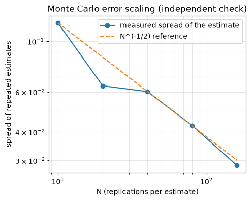
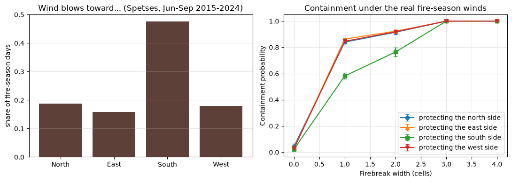
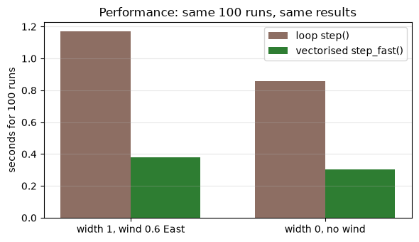

# Theory and mathematics

## 1. Problem formulation

A firebreak is a cleared strip of land with no fuel, used to stop a wildfire spreading. The question here is: how does the width of a firebreak affect the probability that a fire is contained, for different wind strengths and directions, when burning embers can sometimes jump across it?

The forest is modelled as a 2D grid of cells. Each cell is unburned, burning, burned, or part of the firebreak. A fire starts on the left edge and spreads to neighbouring cells at random. The quantity of interest is the probability that the fire burns out before any cell on the far (protected) side of the firebreak catches fire.

## 2. Assumptions

1. Fuel is the same everywhere except in the firebreak (the notebook also has a patchy-fuel version, see Section 6). Slope and fuel moisture are not modelled.
2. Fire can only spread to the 8 cells around a burning cell (the Moore neighbourhood).
3. A cell burns for exactly one time step and then becomes burned.
4. Wind direction and strength stay the same for the whole run.
5. Ember spotting is a simple random jump of 1 to 3 cells in the wind direction, not a physical model of how embers are carried.

## 3. Model equations

Let X(t) be the state of the whole grid at time step t. An unburned cell (i, j) catches fire with probability

$$
p(i,j,t) = 1 - (1 - p_0)^{\,w(i,j,t)}
$$

where p0 is the base ignition probability for one burning neighbour, and w(i, j, t) is a wind-weighted count of the burning neighbours:

$$
w(i,j,t) = \sum_{k \,\in\, \text{burning neighbours}} \Big(1 + s \cdot \max\big(0,\ \hat{d}_k \cdot \hat{u}\big)\Big)
$$

Here d_k is the unit vector from burning neighbour k to cell (i, j), u is the unit vector of the wind direction, and s is the wind strength. If the fire is spreading in the same direction as the wind, the dot product is close to 1 and that neighbour counts for more. If w = 0 (no burning neighbours) the probability is 0. Burning cells always become burned at the next step, and burned and firebreak cells never change, so the next grid depends only on the current grid and fresh random numbers. This makes X(t) a discrete-time Markov chain.

Ember spotting: each burning cell, with probability p_ember per step, can set fire to a cell 1 to 3 cells away in the wind direction, even if there are firebreak cells in between. The target cell must be unburned.

The containment probability for one setting is estimated from N independent runs:

$$
\hat{P}_{\text{contain}} = \frac{1}{N}\sum_{r=1}^{N} Y_r, \qquad \text{SE} = \sqrt{\frac{\hat{P}_{\text{contain}}(1-\hat{P}_{\text{contain}})}{N}}
$$

where Y_r is 1 if run r was contained and 0 if not. The 95% confidence interval is the estimate plus or minus 1.96 SE. By the law of large numbers the estimate gets closer to the true probability as N grows.

| Symbol | Meaning | Units | Value / range | Source |
|---|---|---|---|---|
| L | Grid side length | cells | 50 (40 to 80 in the resolution check) | Chosen to balance detail and runtime |
| W | Firebreak width | cells | 0 to 6 | Varied in the experiments |
| p0 | Base ignition probability | probability | 0.3 for the grid-resolution check, Experiments 1-3 and the sensitivity sweep (default of `containment_probability`); 0.25 for the single example run, the error-scaling check and the vegetation-density extension | Assumed; tuned so results are not always 0% or always 100% |
| s | Wind strength | 0 to 1 (no units) | 0.0 to 1.0 | Varied in the experiments |
| p_ember | Ember spotting probability | per burning cell per step | 0.05 | Assumed; tuned together with p0 |
| N | Monte Carlo runs per setting | count | 80 to 150 (10 to 160 in the error-scaling check) | Enough for a usable 95% CI within the runtime limit |

## 4. Numerical method

Each time step computes the new grid from a copy of the old grid, so every cell is updated from the same snapshot and the update order does not matter. Random numbers come from a seeded generator (NumPy's default generator in the notebook, the mulberry32 generator in the web demo), so any run can be repeated exactly from its seed. Grid size and time step are fixed inside each experiment. Check 6 below compares two grid sizes to see how much the grid resolution affects the answer.

**Stability.** The scheme has no step-size stability limit like the CFL condition of explicit PDE solvers. The time step is the model's own unit (one step is the time a cell takes to burn out), not an approximation of a continuous equation, so there is nothing that can blow up. For any w >= 0 and 0 <= p0 < 1, the ignition probability 1 - (1 - p0)^w stays between 0 and 1. Every cell is always in one of the four states, and the total number of cells is conserved (Check 2). Every run also ends: a cell can burn only once and at least one cell burns in every step while the fire is alive, so a fire on an L x L grid goes out within L^2 steps. The `max_steps = 200` limit is only a safety cap.

**Accuracy.** The main numerical error is the Monte Carlo sampling error. It shrinks like 1/sqrt(N) (measured in extension X2) and is reported as a 95% confidence interval. The other error comes from the fixed grid, which Check 6 shows does affect the probabilities, so the results apply to the 50 x 50 grid used.

**Units.** The model is dimensionless: lengths are in cells (grid spacing = 1), time is in steps, and p0 and p_ember are probabilities per cell per step.

## 5. Verification

| Check | Expected | Obtained | Pass? |
|---|---|---|---|
| Burned cells never re-ignite | No burned cell changes state | None changed in 60 steps | Yes |
| Total number of cells is conserved | Count stays the same every step | Stayed at 1,600 for all 80 steps | Yes |
| Zero ignition probability | Fire cannot spread past the starting cells | Only the 3 starting cells burned | Yes |
| No ember spotting and a full-width firebreak | Fire is always contained | Contained in 20 of 20 runs | Yes |
| Same seed gives the same result | Identical outcome | Identical outcome and burned count | Yes |
| Grid resolution | See whether the result changes with grid size | 0.483 (40x40, width 2) vs 1.000 (80x80, width 4) | Shows the result depends on resolution, so values are specific to the 50x50 grid |
| Monte Carlo error scaling (Section 6) | Log-log slope close to -0.5 | -0.47 | Yes |

## 6. Extensions

The notebook (Section 6) adds five things to the core model:

- **Monte Carlo error scaling:** the whole containment estimate was repeated 15 times at N = 10, 20, 40, 80 and 160 runs, and the spread of the repeated estimates was plotted against N on log-log axes. The fitted slope was -0.47, close to the -0.5 expected for a Monte Carlo estimator. This is a second check of the estimator that does not depend on the main experiments.
- **Patchy vegetation density:** each cell gets a density multiplier between about 0.5 and 1.5 from a smooth random field, and p0 is multiplied by it. At width 1, wind 0.5 East, patchy fuel gave a containment probability of 0.380 +/- 0.095 against 0.270 +/- 0.087 for uniform fuel. So the uniform-fuel assumption does change the answer.
- **Sensitivity and uncertainty:** containment probability and its 95% CI were computed for every combination of width 0 to 4 and wind strength 0.0 to 0.9 and shown as two heatmaps. The widest interval was at wind 0.3, width 2 (P = 0.500 +/- 0.110). This is what statistics predicts, since the standard error of a proportion is largest at 0.5.
- **Performance (vectorised update step):** in `step()` the wind-weighted count w is built by looping over every burning cell and its 8 neighbours. `step_fast()` computes the same sum with array operations: for each of the 8 neighbour offsets (di, dj) the burning mask is shifted by that offset and added with its weight 1 + s max(0, d_k . u), so each step costs 8 array additions whatever the size of the fire. The random numbers are drawn in the same order as in `step()`, so the same seed must give the same grid. This is checked with `assert` on 300 random grids and on 200 full runs, all identical. On the same 100 runs it took 0.38 s instead of 1.17 s (3.1x faster) at width 1 with wind 0.6 East, and 0.31 s instead of 0.86 s (2.8x) at width 0 with no wind.
- **Real wind data (Spetses Island):** the wind input is taken from a real, cited dataset: the daily maximum 10 m wind speed and dominant direction on Spetses Island, Greece, for every June to September day from 2015 to 2024 (1,220 days, ERA5 reanalysis via the Open-Meteo API, CC BY 4.0, see [data/README.md](data/README.md)). Each day's direction is turned into the direction the wind blows toward and rounded to N, E, S or W; speed v becomes wind strength s = min(1, v / 40 km/h), rounded to the nearest 0.2. The grid is rotated so the protected side is always "East". The containment probability is then averaged over all 1,220 days, with SE^2 = sum_k f_k^2 P_k (1 - P_k) / N, where f_k is the share of days in combination k. The summer wind blows toward the south on 48% of days, so a firebreak protecting the south side reached only 0.581 +/- 0.023 at width 1 and 0.764 +/- 0.034 at width 2, while the other three sides gave about 0.84-0.86 and 0.92. Width 3 contained every run on all sides. Using 30 or 50 km/h instead of 40 km/h moved the south-side values by less than 0.03. This grounds the inputs in real data; it does not validate the outputs, because there is no observed firebreak data to compare with.

## 7. Concepts applied

| Concept | Where it is used |
|---|---|
| Discrete-time Markov chains | The grid update rule: the next grid depends only on the current grid and new random numbers |
| Input modelling and random variate generation | Seeded uniform random numbers decide ignition and ember jumps |
| Monte Carlo simulation and the law of large numbers | Containment probability and its 95% confidence interval from many independent runs, plus the error-scaling check |
| Input modelling from real data | Real wind speeds and directions turned into the model's wind inputs (Section 6) |

## 8. References

See [REFERENCES.md](REFERENCES.md).
