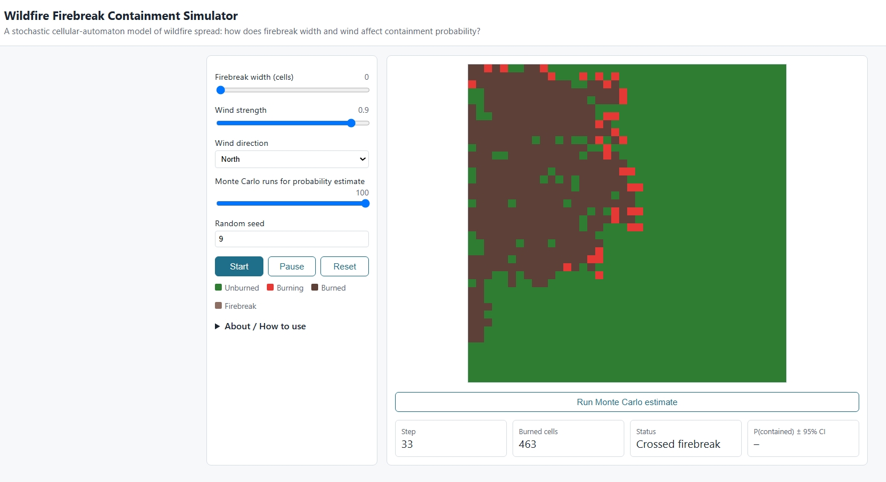

# User guide: Wildfire Firebreak Containment Simulator web demo

**Open the demo:** [https://manithmss.github.io/wildfire-firebreak-simulator/](https://manithmss.github.io/wildfire-firebreak-simulator/). It runs entirely in your browser (current Chrome, Edge or Firefox). Nothing is installed or uploaded.

## Controls

| Control | What it does | Range | Default |
|---|---|---|---|
| Firebreak width | Width of the cleared strip at the centre of the grid (cells) | 0-6 | 2 |
| Wind strength | How strongly wind biases spread toward the wind direction | 0.0-1.0 | 0.5 |
| Wind direction | Which way the wind blows (East blows the fire toward the firebreak) | None/North/South/East/West | East |
| Monte Carlo runs | Number of independent simulations used for the containment-probability estimate | 10-100 | 50 |
| Random seed | Fixes the pseudo-random sequence for the single animated run | any positive integer | 42 |
| Start / Pause | Runs or pauses the single animated simulation | - | - |
| Reset | Clears the run and applies the current settings | - | - |

## Reading the outputs

- **Grid visualisation:** each cell is coloured by state: green (unburned), red (burning), dark brown (burned), tan (firebreak). Watching the animation shows how the fire spreads from the left edge, how the firebreak blocks direct spread, and how ember-spotting can occasionally ignite a cell beyond the firebreak.
- **Step / Burned cells / Status:** running counters for the current animated run, showing how many time steps have elapsed, how many cells have burned or are burning, and whether the fire is still spreading, has been contained, or has crossed the firebreak.
- **P(contained) with 95% CI:** the quantitative output. Pressing "Run Monte Carlo estimate" runs many quick simulations (not animated) at the current settings and reports the estimated probability of containment with a 95% confidence interval, exactly as the notebook does.

## Try this

1. Set firebreak width to 0 and wind direction to East, then click "Run Monte Carlo estimate." With no firebreak at all, containment probability should be very low (close to 0).
2. Increase firebreak width to 4 with the same wind settings and run the estimate again. Containment probability should rise sharply, typically reaching 100%.
3. Keep firebreak width at 1 and compare wind direction East against North or West. East (blowing the fire directly at the firebreak) gives a much lower containment probability than the other directions, because the firebreak lies directly in the fire's path only when wind blows that way.

## Check against the notebook

With the default settings (firebreak width 2, wind strength 0.5, East), the demo's in-browser Monte Carlo estimate (50 runs) gives approximately **0.6-0.8**, consistent with the order of magnitude reported for the equivalent configuration in the notebook's first experiment. Exact values vary between runs and between the notebook and the browser because each uses independent random seeds; this is expected for a Monte Carlo estimate.

## Limitations

- The demo uses a smaller grid (40x40) than some notebook experiments (50x50 or 80x80), to keep the live animation smooth in the browser; absolute probability values can shift slightly with grid size, as shown in the notebook's resolution-sensitivity check.
- The in-browser Monte Carlo estimate uses at most 100 replications for responsiveness, giving a wider confidence interval than the notebook's 150-replication experiments.
- As in the notebook, vegetation density, slope and fuel moisture are not modelled; only firebreak width and wind are adjustable.
